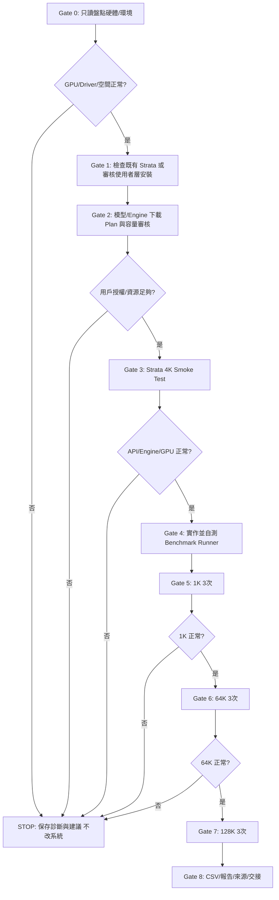
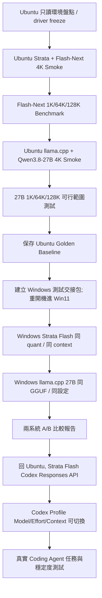

# plan.md — RTX 3080 20GB 雙模型部署、跨系統 Benchmark、Codex 本機 Strata 整合

> **用途**：交接給另一位能操作 Ubuntu Terminal 的 AI Agent。請按照本文件逐關卡執行、產生程式及結果，不要只閱讀後回覆一段建議。
>
> **計畫版本**：2.1（2026-11-15 使用者更新：可用 sudo、GPU 功耗上限固定 250W） ｜**研究基準日**：2026-11-14 ｜**目標平台**：Ubuntu 24.04（先）與 Windows 11（後續 A/B，雙開機）、單張 RTX 3080 20GB 改裝版、Xeon E5-2666 v3、128GB DDR3。
>
> **本次任務**：先以 **Strata + Qwen3.8-Flash-Next** 在 Ubuntu 完成 1K/64K/128K（各預熱一次＋正式三次），再加上 **llama.cpp + Qwen3.8-27B Dense** 的部署與等條件測試；後續以 Windows 11 對兩個相同模型／引擎重跑 OS A/B；最後把 **Strata Flash-Next 接給 Codex CLI**，提供可切換的 Model / Reasoning Effort / Context 配置。詳細新增 Gate 9–18。
>
> **完成狀態（撰寫時）**：只完成研究與執行計畫；**尚未在使用者的 Ubuntu 或 Windows 主機安裝服務、下載模型或執行任何測試**。本文件命令是候選操作，接手 Agent 須按現有版本的 `--help`、官方文件及硬體盤點實際確認。Windows 雙開機測試需切換開機後再執行，不得宣稱 Linux Agent 已完成 Windows 測試。

---

## 0. Agent 的最高優先指示（先讀）

1. **安全、可重現優先，速度次之。** 不修改 NVIDIA Driver、CUDA Toolkit、Kernel、BIOS、GPU clock、GPU firmware、分割區、Windows 開機項或系統套件。使用者已授權必要時使用 `sudo`；所有後續 GPU 實驗必須將 RTX 3080 Power Limit 設為 250W 並驗證。Linux 可執行 `sudo nvidia-smi -i 0 -pl 250`，每次實驗前與期間用 `nvidia-smi --query-gpu=power.limit --format=csv` 核對；若失效則停止測量並重新設定。250W 為上限，實際功耗可低於 250W。不得執行 `apt install`、`apt upgrade`、`nvidia-smi -lgc`、`nvidia-smi -pm` 或 GPU Unlock；不得讓安裝器暗中修改系統。320W 的舊測試獨立保存，不能混入 250W 成績。
2. **允許的寫入範圍**：專案工作目錄、`~/` 內的使用者層 Strata Terminal/Engine/模型資料（當預檢通過、下載量已呈現且經使用者授權）。所有其他既有環境、服務及資料不可覆寫。
3. **先調查、再安裝**：如果 `strata` 已存在，先查版本、可用模型、目前服務、磁碟與安裝方式；不能不必要地重裝、更新或停止別人的 Strata 服務。任何有可能中斷既有請求的 `--stop` / `--restart`，必須先確認可中斷。
4. **安裝與大型下載是獨立關卡**：安裝 Strata 的使用者層 Terminal 可在查驗官方腳本後執行；下載模型與 Engine 前先執行 `--plan`、記錄 GB、SSD 可用空間、RAM/VRAM 估計，再向使用者報告。若沒有足夠空間、需 root、或與「不改系統」衝突，**停止並回報阻礙**，不可自行升級驅動。
5. **使用官方已釋出的 Terminal**，不是 source checkout 的 `setup.sh`、`START-HERE.bat`；這些是不同介面，不可混用 flags。[S1][S2][S3]
6. **模型名稱、版本、flags、路徑不得臆測**：執行前看 `strata launch --help`、`--plan`、官方模型文件、現有 `/metrics` / `/v1/models`；不相容就記錄並停在該關卡。
7. **不偽造成績**：未取得 Engine `timings` 時，`prefill_tps`、`decode_tps` 留 `null`（CSV 留空）；不可用字元數或 HTTP chunk 數冒充 tokens，亦不可用整體 Wall time 算 Decode。[S6]
8. **64K、128K 必須有真實輸入長度證據**。`--context 128k` 是「視窗上限」，不是實際送入 128K token；記錄伺服器 `usage.prompt_tokens`，以及是否截斷、快取重用。[S6][S8][C1]
9. **失敗也要保留**：錯誤、超時、OOM、GPU Xid、短輸出、模型拒絕、token 不足、沒有計時數據皆列入原始結果，不能從報告刪除。只有符合驗收的成功樣本才能納入成功樣本中位數。
10. 每完成一關卡，更新 `progress.md`、`lessons-learned.md`；遇到未知問題做一個最小、可回滾的實驗，不連鎖修改環境。不要推 GitHub、不要上傳模型、log、API key 或私有資料，除非使用者另外授權。

### 目標與非目標

| 類型 | 範圍 |
|---|---|
| 近期主要目標 | Ubuntu 上用 Strata + Qwen3.8-Flash-Next 完成 1K / 64K / 128K，三次有效正式樣本、中位數、GPU 遙測與版本紀錄 |
| 附加目標 | 確認 3080 改裝版顯存穩定，區分冷／熱模型狀態、前綴快取、Prompt 真實長度及品質（Needle recall） |
| 本次新增遠期目標 | Qwen3.8-27B Dense + llama.cpp、Windows 相同模型 OS A/B、Codex CLI 本機 Strata / Responses API / Effort / Context Profiles |
| 非目標 | GPU Unlock、MTP/SageAttention 提前調校、改驅動、追求最高超頻、24h 燒機、修改 Codex 原始碼或保證 `/model` UI 列出第三方 Profiles |
| 執行先後 | Gate 0–8（Ubuntu Strata）→ Gate 9–11（Ubuntu 27B）→ Gate 12–14（Windows 對照）→ Gate 15–18（Codex）；禁止為了後階段破壞前階段已驗收版本 |

### 2026-11-15 最新選模約束（優先於以下舊版 IQ2 指令）

使用者要求後續不使用 Q2／IQ2，至少 Q3，且 Q3 與 Q4 都必須測試。以已下載的 ISTA-DASLab IQ3_S 作為 Strata 主模型；再測已下載的 Unsloth UD-Q4_K_XL（須先驗證完整性和 Strata 相容性）。已取得的 IQ2_XS 成績僅作歷史資料，不再啟動、不納入推薦或後續比較。舊文的 IQ2 指令均視為歷史示例；後續各 Gate 以實際已驗證的 IQ3_S 或 Q4 路徑／family／flags 取代，先 `--plan` 再啟動，不能混淆 provider 或量化。另按原目標實測一個至少 Q3 的 27B Dense（已下載 UD-Q4_K_M）。1K、64K、128K 與使用者新增 256K 按資源條件分級測量，保留失敗；全部固定 250W。

### 2026-11-15 使用者補充：選擇可用於 Codex 的模型

以品質不降低為選模與調整的目標，decode 速度目標至少 30 tokens/s（以固定條件下有效樣本中位數及真實 Codex 任務驗證，非保證所有 context），在可接受的中等速度下優先選擇能與 Codex 工具呼叫、讀檔、修改檔案及執行測試的 Strata 模型；另以 llama.cpp 實測一個 27B Dense。量化或推論最佳化不保證品質與未量化原模型完全相同，應在相同合成 coding、工具呼叫、測試及長文檢索案例上與可用參考配置比較成功率，記錄失敗，不以 tokens/s 宣稱品質不變。保留模型 provider、量化、精度、推論設定與版本；如無可運作的高精度參考，只能回報相對測試結果，不宣稱絕對無損。任何可能改變品質的設定須單因素 A/B，先記錄後決定。 Strata 品質優先 baseline 以 `--set STRATA_ROUTE_TAIL_SKIP=0 --set STRATA_PREFILL_CPU_SHARE=0` 避免已知 expert 跳過及該短 prompt CPU share 的數值變化；需從實際 engine 環境與日誌確認，仍不能保證相同 BF16 品質或完全無浮點差異。所有測試功耗上限固定 250W。

## 1. 階段總覽與 Gate



**約定**：Gate 5~7 每級先「1 次同長度預熱（不計分）」，再 3 次正式測量。若預熱耗用過多 RAM/Swap、出現 Xid 或 OOM，不可繼續正式測量。每級預熱都要獨立留下 `warmup` 紀錄。

## 2. Gate 0 — 唯讀盤點 Ubuntu / RTX 3080 20GB

**目的**：在任何安裝前保存版本與健康狀況，讓未來 Windows/Linux 比較與排障有基準。以 SSH/Terminal 執行；盤點應維持唯讀，必要時可使用已授權的 sudo。

```bash
set -o pipefail
mkdir -p "$HOME/ai-strata-bench"/{docs,scripts,tests,logs,results}
cd "$HOME/ai-strata-bench"

{
  date -Is
  uname -a
  cat /etc/os-release
  python3 --version
  command -v curl || true
  command -v git || true
  command -v strata || true
  nvidia-smi -L
  nvidia-smi
  nvidia-smi --query-gpu=index,name,uuid,memory.total,driver_version,power.limit \
    --format=csv
  free -h
  swapon --show
  df -h "$HOME"
  lscpu | grep -E 'Architecture|Model name|CPU\(s\)|Thread|Socket' || true
} 2>&1 | tee logs/00-baseline.txt

# 這兩項若沒有工具/權限，紀錄為 unavailable；必要時可使用已授權的 sudo 取得唯讀紀錄：
command -v lspci >/dev/null && lspci -nn | grep -i nvidia || true
journalctl -k --since '-1 hour' --no-pager 2>&1 | grep -Ei 'NVRM|Xid' \
  > logs/00-xid-before.txt || true
```

**驗收**：`nvidia-smi` 正常；能確認約 20GB VRAM、Driver Version、空閒 VRAM、RAM、Swap、磁碟剩餘容量；Ubuntu 24.04；知道是否已有其他 GPU 進程佔用。即使 `journalctl` 無權限也不視為整體失敗，但標記 `xid_visibility=unavailable`。

**立即停止的情況**：GPU 無法辨識、顯示記憶體與預期差很多、已知的 Xid/系統異常、使用中的重要服務或空間不足。切勿因版本檢查失敗就安裝/更新 NVIDIA Driver。

## 3. Gate 1 — Strata 安裝（附官方來源）

**目的**：以最少依賴、無 root 的 Strata Terminal 建置可操作的本機服務；不編譯 CUDA。

來源：[S1] 官方 `INSTALL.md`、[S2] 官方 Agent `AI_SETUP.md`、[S3] 官方 `TERMINAL_LAUNCH.md`、[S4] 官方 Release。

**決策分支**：

- **已安裝**：先執行 `strata --version`、`strata launch --help`、`strata launch --status`；記錄版本與使用中的模型。暫不更新。
- **尚未安裝**：檢查 NVIDIA 驅動是否符合官方針對選定 Engine 的最低版本。官方指出 **CUDA 13 Engine 需要 NVIDIA Driver 580+；舊卡或舊驅動依官方文件選 CUDA 12 路線**。不能自行假設已能使用 CUDA 13。[S1]
- 安裝器需要自行下載小型使用者層 Python runtime/Control，後續 `launch` 會取得對應 Engine / model；因此安裝不能描述成「完全唯讀」。[S2]

### 3.1 先下載、審核，不要 `curl | sh`

```bash
cd "$HOME/ai-strata-bench"
mkdir -p downloads
curl -fL --retry 2 --connect-timeout 15 --max-time 120 \
  https://github.com/Niko1221/Strata/releases/latest/download/install.sh \
  -o downloads/strata-install.sh
sha256sum downloads/strata-install.sh | tee logs/01-install-script.sha256
less downloads/strata-install.sh
# 特別檢視所有系統變更、網路下載與檔案刪除動作
rg -n 'sudo|apt |dnf |pacman|modprobe|nvidia|rm -rf|curl|wget' \
  downloads/strata-install.sh || true
```

`rg` 不一定已安裝；若無此工具就以 `grep -En '...' downloads/strata-install.sh` 替代，不得為了搜尋而安裝套件。核對 GitHub 專案、實際連結、腳本行為與預期 HOME 寫入範圍；出現 `sudo`、驅動/系統安裝、意外刪除路徑，先停止。

### 3.2 使用者層安裝

```bash
sh downloads/strata-install.sh
# 若 PATH 沒更新，可先用安裝器列出的實際路徑，例如：
"$HOME/.local/bin/strata" --version
"$HOME/.local/bin/strata" launch --help
"$HOME/.local/bin/strata" launch --status
```

以上是**必要時才執行**的安裝步驟，不是第一行就執行的無條件命令。實際位置以安裝器輸出為準。若官方更新腳本、驗證機制或 flags 有變，以當下版本文件為準，將差異記入 `lessons-learned.md`。

**Gate 1 驗收**：CLI 可輸出版本、help 與 status；無 root、無 driver / CUDA Toolkit 修改；保留安裝器 SHA256 與安裝報告。若已有可用 CLI，跳過安裝。

## 4. Gate 2 — 模型選擇、容量規劃及下載授權

**目的**：先「小成功」再做長 Context。現有 20GB VRAM + 128GB DDR3 可以嘗試 RAM offload，但是否適用取決於**模型、量化、KV cache、SSD 可用空間與實際 Engine**；不能以模型 GGUF 檔案大小直接當 RAM 用量。[S5]

本階段的**正式主模型改為 `Qwen3.8-Flash-Next`（MoE）**。先考慮 Strata 官方列出的 ISTA-DASLab `IQ2_XS`（估計權重約 39.2GB RAM+VRAM，仍須以執行日的 `--plan` 為準），必要時退至 `Q2_0`；透過系統 RAM 與 GPU 混合推論。`Qwen3.6-35B-A3B` 只保留作為 4K 應急 Smoke Test 候選，不能拿它的成績標為 Flash-Next。[S5][S12]

```bash
STRATA="$HOME/.local/bin/strata"   # 如已在 PATH，亦可用 command -v strata
"$STRATA" launch --help | tee logs/02-launch-help.txt
"$STRATA" launch --status | tee logs/02-launch-before.txt

# 不下載、不啟動：先檢視模型/Engine/RAM/磁碟預估
"$STRATA" launch --plan \
  --family qwen --model iq2_xs \
  --context 128k --vision off --parallel 1 \
  --access local --port 8080 \
  --tune skip \
  | tee logs/02-model-plan-128k.txt
```

若目前 CLI 的 `--plan` 不接受其中一個旗標，先看 help、記錄版本差異，再改成**等價且官方明確支援**的選項，不要試錯導致真下載。要明確評估 `--context 128k` 相比 `32k` 是否會令 KV cache / 專家快取超出 VRAM。

**開始下載之前 Agent 必須呈現給使用者**：模型名稱與 provider / revision、下載 GB、預計資料夾、剩餘容量、是否需要 CUDA 12/13、預估 RAM/VRAM、是否會影響既有服務。對大型下載，取得明確授權後才執行 `--yes`。

### 4.1 最小成功：先 4K、不啟用進階加速

首選延續同一模型與同一 quantization，先小 context 啟動：

```bash
# 僅在 Gate 2 容量審核與下載授權通過後執行：
"$STRATA" launch \
  --family qwen --model iq2_xs \
  --context 4k --vision off --parallel 1 \
  --access local --port 8080 \
  --tune skip --yes --no-tui

"$STRATA" launch --status
```

**注意**：`--yes` 不會自動重啟與此設定不同的現有服務；官方要求明確使用 `--restart` 或先停止。Agent 不得擅自強制覆蓋現有服務。[S3]

### 4.2 正式長 Context 的一致性

通過 4K Smoke Test 後，再查看 128K 的 `--plan`；若支持且能啟動，使用**同一個 128K server 設定**跑三種「實際輸入長度」級別，以避免不同 context 設定影響 VRAM 與 expert cache，造成測試不公平。

```bash
# 執行前先確定既有服務可以中斷；必要時安排可中斷窗口。
"$STRATA" launch --plan \
  --family qwen --model iq2_xs --context 128k \
  --vision off --parallel 1 --access local --port 8080 \
  --tune skip

# --restart 僅在使用者同意中斷現有服務時使用：
"$STRATA" launch \
  --family qwen --model iq2_xs --context 128k \
  --vision off --parallel 1 --access local --port 8080 \
  --tune skip --yes --no-tui --restart
```

不要臆測 128K 的 KV 量化、drafting/MTP 預設值；從 log、launch 設定與 `/metrics` **讀取實際值**，完整保存。若 128K 不能啟動，退回已經通過的 4K Smoke Test，回報 `128K BLOCKED`，**不可為求 128K 成功去改 Driver 或全域記憶體設定**。

## 5. Gate 3 — 確認 Strata API、模型及 GPU Offload

**目的**：在花時間產生長 Prompt 前，先確認 API 正常、是否真的在 NVIDIA GPU 運行、驗證 `usage` / `timings` 來源。[S6][S7]

```bash
# API 默認僅本機 127.0.0.1:8080；實際地址以 Strata 輸出為準
curl -fsS http://127.0.0.1:8080/v1/models | tee logs/03-models.json
curl -fsS http://127.0.0.1:8080/metrics | tee logs/03-metrics.json
```

若啟用 API Key，從 Strata 官方安全途徑取得並放在**當前 shell 的環境變數**，不得寫進命令 log / CSV / Git / 報告。`/v1/models` 或 `/metrics` 若需要認證，附上 `Authorization: Bearer ...`；不得直接關閉認證來繞過問題。

Smoke Test（參照官方 OpenAI 相容 API，模型 ID 以 `/v1/models` 實際回傳為準；`strata` 僅為示例）：

```bash
# 如果有 API Key，請使用 -H "Authorization: Bearer $STRATA_API_KEY"
curl --fail-with-body -sS -N http://127.0.0.1:8080/v1/chat/completions \
  -H 'Content-Type: application/json' \
  -d '{
    "model": "strata",
    "messages": [{"role": "user", "content": "請用繁體中文說一句你能正常運作的確認訊息。"}],
    "temperature": 0,
    "max_tokens": 64,
    "stream": true,
    "stream_options": {"include_usage": true},
    "reasoning_effort": "none"
  }'
```

**驗收**：HTTP 成功、收到非空文字或 reasoning/tool delta、最後有正確 finish reason；記錄 `/metrics`、回傳 `usage.prompt_tokens`、`usage.completion_tokens`、`timings`（若有）、GPU VRAM 使用增加／GPU 負載、Engine 實際版本。若是模型不支援 `reasoning_effort`，以官方文件驗證的禁思考格式取代，並註明差異；不能暗中改變不同 run 的模式。

## 6. Gate 4 — 建立專用 Benchmark Runner（Python 3 標準函式庫優先）

**目的**：官方 `tools/strata_bench.py` 能做一般社群跑分與 4K/16K/32K 測試，但**不直接涵蓋本次指定的 1K、64K、128K + 每輪 GPU 遙測 CSV**。因此先以官方工具當度量規則，再補寫 `scripts/strata_longctx_bench.py`。[S6][S8]

### 6.1 必須提供的 CLI

```text
python3 scripts/strata_longctx_bench.py --help
python3 scripts/strata_longctx_bench.py --url http://127.0.0.1:8080 \
  --levels 1k,64k,128k --repeats 3 --warmups 1 \
  --output-tokens 256 --output-tokens-1k 128 \
  --gpu-index 0 --out results/<run-id> --dry-run

# 正式運行應需明確 --execute；無此參數只能 dry-run / 驗證。
python3 scripts/strata_longctx_bench.py --url http://127.0.0.1:8080 \
  --levels 1k --repeats 3 --warmups 1 --execute --out results/<run-id>
```

`--levels` 代表**目標實際 Prompt 長度級別**；`configured_context_tokens` 是 Server 上限，兩者一定要分欄。`--execute` 前自動檢查模型啟動與實際 context；若處於 4K smoke server，`--levels 64k,128k` 必須拒絕執行。

### 6.2 輸入長度驗證與公平性

- 1K / 64K / 128K 分別以 **1024 / 65536 / 131072** 作為級別名，**不是要求輸入滿額且沒有輸出空間**。
- 128K Server 的實際輸入預設目標：接近該級別的 **95%**（例如 64K ≈ 62K、128K ≈ 124K），同時預留聊天模板、輸出 256 tokens、KV 安全空間。1K 可輸入約 768 tokens、輸出 128 tokens。將 `target_prompt_tokens`、`actual_prompt_tokens`、`configured_context_tokens`、`max_new_tokens` 各自紀錄。
- 不可以用純文字字元數宣稱 token 數；若伺服器提供經驗證的 `/tokenize` 或其他官方 tokenization 介面，優先使用，且必須包含 chat template；若不可用，**以伺服器 `usage.prompt_tokens` 為正式依據**，用小型探測請求校準長度。校準請求不能混入正式測量。
- 預設長 Context 測試須達到**至少級別 90% 的真實 Prompt tokens**且 `actual_prompt_tokens + max_new_tokens <= configured_context_tokens`；未達標標記 `input_too_short`，不是正式有效樣本。也要偵測可能的 truncation / overflow，不能假裝 128K 成功。
- Prompt 用固定生成器及 seed，構成「多段不同的」合成程式碼/文件段落，避免單一句子重複數萬次、壓縮性過強；不讀取私有原始碼。每次正式請求的開頭放獨立 nonce，減少前綴快取污染，保存 Prompt 生成器版本和 SHA256。
- 每個級別一個同長度 warm-up，不計入中位數；正式三次皆保持同 `temperature`、sampling、`max_tokens`、模型、Strata/Engine 設定、已載入狀態。保留每次 `cached_tokens`，若冷前綴測試快取率大於 1%，標註 `cache_contaminated`，排除冷 Prefill 中位數。
- 請求是 `stream: true`，要求 `stream_options.include_usage=true`；務必解析串流尾段 `usage` 和 `timings`，並保存原始欄位與缺失原因。[S6]
- `max_tokens=256` 是**上限不是保證**。保留實際 `completion_tokens` 和 `finish_reason`；若不足要求（例如少於 90%）、中途 EOS 或過早停止，標記 `short_output`，速度可以獨立觀察但不能列為「完整 256 tokens 成功」；禁止用人為虛構 token 補足。
- 主效能測試關閉 reasoning/thinking（若所選模型支援），避免 256 tokens 全部花在隱藏 reasoning；保留實際設定。長上下文 **Recall** 是額外測試，不與純吞吐混成同一數字。

### 6.3 Metrics 的唯一合法定義

| CSV 欄位 | 計算與證據 | 無法取得時 |
|---|---|---|
| `prefill_tps` | `timings.prompt_n / (timings.prompt_ms/1000)`，依官方規則剔除 cached tokens | 空值 + `missing_timing` |
| `decode_tps` | `timings.predicted_n / (timings.predicted_ms/1000)`，檢查與 `predicted_per_second` 一致；以官方解釋的 engine count 為準 | 空值 + `missing_timing` |
| `ttft_ms` | Client monotonic clock 從發出 HTTP request 到**第一個非空 reasoning / answer / tool delta**；忽略 headers/role-only/keepalive | 空值 + `no_first_delta` |
| `first_answer_ms` | Client 第一個正文內容／工具輸出（不含 reasoning） | 空值 |
| `total_ms` | 發出請求到 streaming 結束、錯誤或取消 | 永遠記錄或明確錯誤 |
| `prompt_tokens` | 伺服器 `usage.prompt_tokens` | 空值 + 原因 |
| `cached_tokens` | `usage.prompt_tokens_details.cached_tokens`，否則 `timings.cache_n` | 空值 + 原因 |
| `completion_tokens` | 伺服器 `usage.completion_tokens` | 空值 + 原因 |
| `gpu_peak_vram_mib` | 該 run 期間 `nvidia-smi` GPU 已用 VRAM **最高取樣值** | 空值 + `telemetry_unavailable` |
| `gpu_peak_temp_c` | GPU 溫度最高取樣 | 空值 |
| `gpu_power_avg_w`, `gpu_power_peak_w` | GPU 瞬時功耗的時間平均與取樣峰值 | 空值 |
| `gpu_util_avg_pct`, `ram_peak_gib`, `swap_peak_gib` | 遙測結果 | 空值 |

**不能**把 `ttft_ms` 當 `prefill_ms`，也不能把 `(completion_tokens/total_ms)` 叫 Decode。[S6]

### 6.4 GPU/主機遙測與錯誤

每個 run 期間以約 **1 秒**取樣 GPU（不需 root），例如：

```bash
nvidia-smi \
  --query-gpu=timestamp,index,memory.used,utilization.gpu,temperature.gpu,power.draw,clocks.sm \
  --format=csv,noheader,nounits -l 1
```

Agent 可以用 Python `subprocess` 定時呼叫取樣，再寫入 `telemetry.csv`。若某個欄位不支援則退化到最小欄位集；不能整個測試崩潰。將 `nvidia-smi` 的整張卡使用量記為 `device_vram_used`，**不要誤稱為 Strata Process 專屬 VRAM**。

同時取 `free` / `/proc/meminfo` RAM、Swap；收集 Kernel Xid（若無權限，記錄 unavailable）。每次測試前後 `nvidia-smi` 快照，追蹤 OOM、非零 exit code、HTTP 400/500、API 斷線、超時、模型載入失敗、GPU reset 和降頻。

**Stop conditions**：GPU power limit 非 250W、新的 Xid/driver reset、主機接近 OOM 或發生 swap thrash、連續錯誤、無法恢復的 Engine 錯誤。此時立刻停止下一輪、保留 logs；**不得改驅動或提高功耗**。

### 6.5 Runner 自動化測試（不用 GPU）

至少使用 Python `unittest` 或自帶 fixture 驗證：

1. SSE 中 `data: [DONE]`、空 keepalive、只有 role 的 chunk、`reasoning_content`、正常 content、尾段 `usage`/`timings`。
2. 缺少/無效 `usage`、`timings`、0 秒、JSON 格式錯誤、HTTP 500、逾時時輸出 `null` 而非 NaN/0。
3. `cached_tokens` 太高、輸出不足、Prompt 太短、沒有第一字、Token 上限溢出都能產生對應 `status`。
4. 成功樣本三次中位數、失敗計數、CSV 欄位順序與數值單位一致。
5. 模型／設定相同才允許合併中位數；失敗與 warm-up 不混入。

## 7. Gate 5–7 — 正式 Benchmark 執行順序

| Gate | 級別 | 輸出上限 | 預熱 | 正式次數 | 通過後才能做 |
|---|---|---:|---:|---:|---|
| 5 | 1K | 128 | 1 | 3 | 64K |
| 6 | 64K | 256 | 1 | 3 | 128K |
| 7 | 128K | 256 | 1 | 3 | 結果分析 |

第一次可在 4K Server 先做只含 1K 的**Smoke Benchmark**，確認 runner 正常；**正式對照表**必須在相同 Server `128K` 設定下全部重新測一次，不能混入 4K Server 的 1K 成績。

正式執行前要確定 `/metrics` 回報的 `max_context`（若 endpoint 沒有，從 launch config 與 engine log 雙重確認）。記錄每級開始/結束時間；每級 `--dry-run` 檢查輸出參數；依序單一執行，不能並發。

```bash
# 先確定 runner --help / --dry-run 通過，再正式啟用
python3 scripts/strata_longctx_bench.py \
  --url http://127.0.0.1:8080 --levels 1k \
  --repeats 3 --warmups 1 --execute --out results/<run-id>

python3 scripts/strata_longctx_bench.py \
  --url http://127.0.0.1:8080 --levels 64k \
  --repeats 3 --warmups 1 --execute --out results/<run-id>

python3 scripts/strata_longctx_bench.py \
  --url http://127.0.0.1:8080 --levels 128k \
  --repeats 3 --warmups 1 --execute --out results/<run-id>
```

`<run-id>` 須替換為固定的、已建立的資料夾名稱，例如 `2026-11-14-rtx3080-20g-strata-qwen38-flash`；不能直接把角括號貼進 Bash。CLI 的 `--out` 行為與合併方式由 Agent 實作、寫入 README；三段測試要保存到同一 run 之下的不同 level 子目錄，再統整，**不可覆寫之前的結果**。

**長測試超時**：每檔 timeout 可設定為保守值（例如 1K 10m、64K 45m、128K 90m），這是安全截止門檻**不是預估測試需時**。超時記成 `timeout` 並停止該級後續正式請求，勿隨意重試造成系統負擔。

### 7.1 使用者新增：256K context

在 128K 測試成功且無 Xid、OOM 或明顯換頁壓力後，於同一模型獨立啟動 `--context 256k` 的 250W server，記錄啟動時間、實際 context/KV、RAM、swap、功耗及頻率。以 server `usage.prompt_tokens` 證明實際輸入達 256K 級的至少 90%，目標約 95%，保留輸出空間；預熱一次、正式三次，輸出上限 256 tokens。若不支援或資源不足，保存失敗並標記 256K BLOCKED，恢復較小 context；不得以設定值當實際 token。與 128K server 的結果因 configured context 不同，必須標明不是完全等設定比較。

## 8. Gate 8 — 報告、CSV、驗收與 Lessons Learned

### 8.1 產出目錄

```text
~/ai-strata-bench/
├── plan.md                 # 本文件
├── progress.md             # Agent 逐關卡進度與時間戳
├── lessons-learned.md      # 現象/根因(證據)/修復/回滾/來源
├── README.md               # 最小重現流程與相容性限制
├── docs/
│   ├── sources.md          # 引用版本與查閱日期
│   └── benchmark-method.md # 規格、公式、資料品質條件
├── scripts/
│   └── strata_longctx_bench.py
├── tests/
│   └── test_benchmark.py
├── logs/
│   ├── 00-baseline.txt
│   ├── 01-install-script.sha256
│   ├── 02-model-plan-128k.txt
│   └── ...
└── results/
    └── <run-id>/
        ├── environment.json
        ├── summary.md
        ├── raw.csv
        ├── median.csv
        ├── requests.jsonl
        ├── telemetry.csv
        ├── errors.jsonl
        ├── level-1k/
        ├── level-64k/
        └── level-128k/
```

### 8.2 `raw.csv` 最少欄位

```text
run_id,level,trial,phase,status,error_code,started_at,server_context_tokens,target_prompt_tokens,actual_prompt_tokens,cached_tokens,max_output_tokens,completion_tokens,finish_reason,model_id,quantization,strata_version,engine_version,driver_version,reasoning_setting,kv_setting,drafting_setting,prefill_ms,prefill_tps,decode_ms,decode_tps,ttft_ms,first_answer_ms,total_ms,gpu_peak_vram_mib,gpu_peak_temp_c,gpu_power_avg_w,gpu_power_peak_w,gpu_util_avg_pct,ram_peak_gib,swap_peak_gib,cache_contaminated,token_validation,notes
```

`median.csv`：每個級別各一列，欄位必須包含 `valid_n`、`failure_n`、`warmup_n`，及**成功且有效樣本**之 `prefill_tps_median`、`decode_tps_median`、`ttft_ms_median`、`gpu_peak_vram_mib_median`、`gpu_peak_temp_c_median`、`gpu_power_avg_w_median`、`total_ms_median`。未達 3 次有效樣本須標記 `INCOMPLETE`；不得把 1～2 次結果宣稱三次中位數。

### 8.3 核心驗收

- [ ] `environment.json` 可交代 Ubuntu/Kernel/CPU/RAM/GPU 20GB/Driver/Strata/Engine/模型完整版本及設定。
- [ ] 1K、64K、128K 各 1 warm-up + 3 正式 run（如某級未完成，明確記錄 BLOCKED/FAILED，絕不能假裝成功）。
- [ ] 保留每次 `usage` 和 `timings`；Prefill / Decode 取 Engine timing，TTFT 取 client monotonic。
- [ ] 64K、128K 有實際 Prompt token 計數；未達標/截斷/快取污染不能混入合格的中位數。
- [ ] GPU VRAM、溫度、功耗、RAM/Swap、Xid/不可見原因有紀錄。
- [ ] `raw.csv`、`median.csv`、`requests.jsonl`、`telemetry.csv`、`summary.md` 能相互核對，且完成單元測試。
- [ ] 無管理員權限修改、無 Driver/CUDA/BIOS/Clock/Power 修改；保留已成功的最小工作狀態。

### 8.4 `summary.md` 建議模板

| Context 級別 | Prompt tokens 中位數 | Prefill t/s 中位數 | Decode t/s 中位數 | TTFT(s) 中位數 | VRAM 峰值 MiB 中位數 | 溫度峰值℃ 中位數 | 功耗平均 W 中位數 | 有效/失敗 |
|---|---:|---:|---:|---:|---:|---:|---:|---|
| 1K | 待測 | 待測 | 待測 | 待測 | 待測 | 待測 | 待測 | 待測 |
| 64K | 待測 | 待測 | 待測 | 待測 | 待測 | 待測 | 待測 | 待測 |
| 128K | 待測 | 待測 | 待測 | 待測 | 待測 | 待測 | 待測 | 待測 |

上述空白範例**不是實測結果**。需附原始 CSV、設定、背景工作負載、是否 GPU 時脈下降，以及樣本數與不確定性。不得以單一使用者的 LCZ 成績當成我們機器的驗收門檻。

## 9. 官方對照與長 Context 正確性驗證（可選，正式效能完成後）

- Strata 官方 `tools/strata_bench.py`：若已有官方 source checkout，可檢查 `--help`，在**另一個 results 目錄**測社群既定工作負載；不要直接把它的 4K/16K/32K 與本次 1K/64K/128K 混成一個中位數。[S8]
- 官方 `tools/needle_bench.py`：確定可接受 Context 後，用 64K / 128K，插入 10%/50%/90% 深度的秘密字串測檢索成功率。該工具有自訂 token 近似，因此正式採用它輸出的 `actual prompt tokens`；失敗/跳過也要保留。[S10]
- Strata Terminal 的 `strata bench run` 是**另一套標準 Benchmark**，與本次自訂長 Context suite 不同；可留待下一階段做專案間可比性實驗。[S11]

## 10. 風險與避免踩坑（供 Linux Agent 判斷）

| 風險 | 早期訊號 | 動作／停止條件 | 依據 |
|---|---|---|---|
| CUDA/Driver 不相容 | Engine 無法初始化、`nvidia-smi` 正常但 CUDA runtime 報錯 | 記錄版本與錯誤、停在安裝 Gate；不升級 Driver | [S1][S2] |
| GGUF 已下載但 RAM/VRAM 不夠 | `--plan` memory tight、Engine OOM、Swap 暴增 | 停止進階 Context；保留最小可用設定 | [S5] |
| 128K 只是設定值 | `usage.prompt_tokens` 明顯不足或回答截斷 | 記錄 `INVALID_CONTEXT`，重做輸入校準，不能認作成功 | [S6][C1] |
| Prefix cache 讓 Prefill 虛快 | `cached_tokens` > 1% | 記為 cache contaminated，唯一 nonce / 隔離重新跑 | [S6][S8] |
| TTFT 與 Prefill 混淆 | TTFT ≠ engine prompt_ms | 分欄；缺 Engine timings 就留空 | [S6] |
| 輸出 256 未達標 | `completion_tokens` 少、finish_reason `stop` | 記短輸出；不納入完整輸出對照 | [S6] |
| 改裝 GPU / 老 X99 穩定性 | 新 Xid、主機凍結、RAM/Swap thrash、溫度異常 | 停止負載、保存 log，必要時回退最小成功 | [C1][C2] |
| 舊文章命令與現版混用 | flag 不支援／模型 family 變動 | 以 release 版 docs + `--help` 為準 | [S1][S3] |

## 11. Agent 最後必須交付的回覆

完成後回報：**(a)** 實際完成到哪個 Gate；**(b)** Strata/Engine/模型/Driver/Ubuntu 版本；**(c)** 1K、64K、128K 逐級通過或失敗、實際 Prompt tokens 與失敗原因；**(d)** `raw.csv`、`median.csv`、`environment.json`、`summary.md` 所在位置；**(e)** 是否發生 Xid/OOM；**(f)** Lessons Learned 與下次重跑命令；**(g)** 任何本計畫未授權、因此未執行的變更。

若受限於硬體或安裝條件，仍須交付**已完成的檢查紀錄、可執行的 runner、測試 fixtures、阻礙清單**；不可只說「因故無法完成」。

---

## 12. 參考來源與安裝依據

> **來源使用原則**：官方文件優先作為「如何安裝、API / flags 與測量定義」的依據；LCZ 是同級硬體的實戰案例與風險線索，**不能當成官方相容性保證**。以下 URL 為 Agent 必須查閱的原始資料，執行日應確認 release 是否已更新並記錄查閱日期。

### 官方安裝與使用（優先閱讀）

- **[S1] 官方安裝說明（必讀，包含 CUDA Engine 與 Driver 門檻、CLI 安裝命令）**  
  https://github.com/Niko1221/Strata/blob/main/docs/INSTALL.md
- **[S2] 官方給 AI Agent 的安裝指南（必讀，無 root、下載規劃、安全原則）**  
  https://github.com/Niko1221/Strata/blob/main/docs/AI_SETUP.md
- **[S3] 官方 `strata launch` 說明（`--plan`、`--context`、`--no-tui`、`--restart`、access / key）**  
  https://github.com/Niko1221/Strata/blob/main/docs/TERMINAL_LAUNCH.md
- **[S4] Strata Releases（查當次確切安裝版本及 assets）**  
  https://github.com/Niko1221/Strata/releases
- **[S5] 官方模型與資源要求（確認 family、quant、硬體容量、磁碟）**  
  https://github.com/Niko1221/Strata/blob/main/docs/MODELS.md
- **[S9] Qwen3.6-35B-A3B 運行細節（含 VRAM、KV、Context 相關限制）**  
  https://github.com/Niko1221/Strata/blob/main/docs/QWEN36.md
- **[S7] 官方 API 與整合資料（OpenAI 相容端點、實際 key 使用）**  
  https://github.com/Niko1221/Strata/blob/main/docs/AI_REFERENCE.md

### 官方 Benchmarks 與正確性驗證（必讀）

- **[S6] Strata Benchmark Protocol（核心指標定義、usage/timings/TTFT、cache 計數）**  
  https://github.com/Niko1221/Strata/blob/main/docs/BENCHMARK_PROTOCOL.md
- **[S8] Community Benchmarks（官方腳本、三次測量、cache 與 metadata、失敗處理）**  
  https://github.com/Niko1221/Strata/blob/main/docs/COMMUNITY_BENCHMARKS.md
- **[S10] 官方 `needle_bench.py`（真正長 Context 的 recall 測試）**  
  https://github.com/Niko1221/Strata/blob/main/tools/needle_bench.py
- **[S11] Strata Terminal Bench 子指令（標準 suite；不可與本計畫自訂 suite 混淆）**  
  https://github.com/Niko1221/Strata/blob/main/docs/TERMINAL.md

### LCZ 同卡社群案例（僅作參考、驗證方法與風險提示）

- **[C1] Ubuntu 24.04.5 + 魔改 RTX 3080 20GB + DDR3/X99，Strata 8K～256K 長輸入**：實測作者使用的是雙路 Xeon、256GB DDR3，與本機單路 128GB 不同；不能照搬速度或記憶體配置。  
  https://lcz.me/topic/2988
- **[C2] 單張 RTX 3080 20GB + Strata + IQ2_XS、128K Context 設定與踩坑**：作者自述部分測試還沒涵蓋真正滿上下文，記得區分 configured window / actual prompt。  
  https://lcz.me/topic/1987

### 新增必讀來源（第二階段與 Codex 整合）

- **[S12] Strata Flash-Next 量化／RAM／VRAM／模型家族清單**：https://github.com/Niko1221/Strata/blob/main/docs/MODELS.md
- **[S13] Strata 作者明言 Qwen3.8-27B Dense 不屬於 Strata 支援範圍，應使用 llama.cpp**：https://github.com/Niko1221/Strata/issues/770
- **[S14] Qwen3.8-27B 官方模型卡，含原生 context、模型架構**：https://huggingface.co/Qwen/Qwen3.8-27B
- **[S15] ggml-org 的 Qwen3.8-27B GGUF，供 llama.cpp 使用，檢查最新檔案及 quant**：https://huggingface.co/ggml-org/Qwen3.8-27B-GGUF
- **[S16] llama.cpp 官方 Repo 與 Releases，選 Windows/Linux CUDA 相容預編譯版本**：https://github.com/ggml-org/llama.cpp ；https://github.com/ggml-org/llama.cpp/releases
- **[S17] Strata AI_REFERENCE.md：OpenAI Responses、`strata connect codex`、`--check` 等**：https://github.com/Niko1221/Strata/blob/main/docs/AI_REFERENCE.md
- **[S18] Strata DETAILS.md：Codex `config.toml`、Responses 串流、reasoning、Context、安全限制**：https://github.com/Niko1221/Strata/blob/main/docs/DETAILS.md
- **[S19] Strata 實際 Codex adapter 原始碼（當文件與版本不一致時優先依實際安裝版本）**：https://github.com/Niko1221/Strata/blob/main/strata_cli/launch/harness.py
- **[S20] OpenAI Codex 官方設定參考：profiles、providers、context 與 auto-compaction**：https://learn.chatgpt.com/docs/config-file/config-reference
- **[S21] Codex GitHub 原始碼配置定義（驗證現行 key 支援）**：https://github.com/openai/codex/blob/main/codex-rs/config/src/config_toml.rs
- **[S22] Codex Issue #22160：第三方模型／profiles 未必出現在互動 `/model` 列表，不能承諾有 GUI 切換**：https://github.com/openai/codex/issues/22160
- **[S23] Strata 官方標準 Bench；protocol 是 draft，與自訂 1K/64K/128K 不同**：https://github.com/Niko1221/Strata/blob/main/docs/BENCHMARK_PROTOCOL.md
- **[S24] llama.cpp Server 官方 `/v1/responses` / tool API 文件**：https://github.com/ggml-org/llama.cpp/blob/master/tools/server/README.md
- **[S25] Codex + llama.cpp 特定新版 Responses `additional_tools` 不相容案例**：https://github.com/ggml-org/llama.cpp/issues/30859
- **[C3] LCZ 同卡 Windows／Linux 相關 Qwen / Strata 使用紀錄**：https://lcz.me/topic/243 ；https://lcz.me/topic/2988

### 來源可信度與未驗證事項

- 官方的最新 Release、Engine 對 RTX 3080 20GB **改裝版** 的實際兼容性，以及這台主機能否啟動 Qwen3.8 Flash-Next 128K：**尚未在目標機驗證**。
- LCZ 文章的數字是個別使用者配置與測試，非實驗室跨系統公平對照。
- 你拿到的是執行計畫，不是 benchmark 完成證明；一切性能數據必須以實機 `results/` 為準。

---

## 13. 給接手 Agent 的首段任務（可直接貼上）

> 請在本機 Ubuntu 24.04 按 `plan.md` 實作與執行。首先只做 Gate 0 唯讀盤點；接著按官方 `AI_SETUP.md` / `INSTALL.md` 檢查是否已有 Strata，必要時僅做使用者層安裝並先審核腳本。執行 `strata launch --plan`，列出模型下載量與容量後再下載。先完成 4K Strata Smoke Test，再製作使用 Python stdlib 的 `strata_longctx_bench.py`（含 unittest、SSE parsing、timings、GPU 監控與 CSV）。正式比較在相同 128K Server 設定下依序測 1K/64K/128K，各一個同長度 warm-up、三次正式測試，最大輸出 128/256/256。不能修改 Nvidia Driver、CUDA、Kernel、BIOS、GPU clock 或既有 Windows 開機設定；sudo 已獲授權，後續實驗 GPU power limit 固定 250W 並驗證。遇到未知問題先停止、保留證據，更新 progress/lessons-learned；回覆所有結果檔案路徑與成功/失敗狀態。


---

# 第二部分：新增目標 — Qwen3.8-27B、Windows/Linux 對照、Codex Strata（Gate 9–18）

> **執行優先權**：Gate 0–8 已有 Strata Flash-Next 的流程；**先做完 Gate 0–3 的短文最小成功**。如果新任務的某個階段遇到阻礙，就保存紀錄並跳回可工作的狀態，不擅自修改 Driver/CUDA/BIOS/硬碟分割區。下面是獨立的後續 Roadmap，不得把它解讀成「立刻一次執行所有下載」。
>
> **核心事實**：Qwen3.8-27B 是 **Dense**；Strata 作者於 Issue #770 表明不支援該 Dense 27B 的高效離載，建議用 llama.cpp。[S13] Strata 要用 **Qwen3.8-Flash-Next (MoE)**。[S12] 兩種模型的 throughput 不能視為同模型比較。

## 14. 整體架構、階段與完成定義



**完成定義 / Definition of Done（必須可客觀證明）**：

1. Ubuntu：Strata Flash-Next `4K` Smoke Success；1K、64K、128K 各有預熱＋三次正式測試**或有明確 BLOCKED 原因**；`raw.csv`、`median.csv`、遙測、版本與配置可回放。
2. Ubuntu：llama.cpp + Qwen3.8-27B Dense 小 Context 能推論；依實際記憶體可行性逐級測 1K／64K／128K，不因 128K 無法跑就把整個專案判失敗。保存量化檔與 SHA256。
3. Windows：同卡、同模型檔、同量化、相近設定重跑，產生**獨立**報告；不同 OS 的 Driver 和 binary build 另記，不宣稱完全相同引擎二進位。
4. Codex：以 `/v1/responses` 成功執行一輪工具呼叫與檔案修改，至少 `low` / `medium` / `high` 三種 effort 及 32K／64K 可切換；`model_context_window` 不超過實際 server context；實際使用自己的 Linux Codex CLI 驗證而不是只提交設定檔。
5. 保持 Ubuntu/Windows 雙開機正常，無系統驅動與電力設定修改；失敗有重現方式、錯誤與復原步驟。

### 原則：不可混為一談的四種比較

| 比較類型 | 可比條件 | 能下的結論 |
|---|---|---|
| OS A/B（Flash） | **同 Flash-Next + 同量化檔與 provider + 同 Strata release/config + 同 prompt** | Windows 與 Ubuntu 在這套設定下的差異 |
| OS A/B（Dense） | **同 27B GGUF SHA256 + 同 llama.cpp commit + 同 offload/ctx/seed** | Windows 與 Ubuntu 在這套 Dense 設定下的差異 |
| Dense vs MoE | 相同題目與輸出標準，但**不同模型與引擎** | 使用體驗、品質、TTFT、端到端效率；不能宣稱「OS 優劣」 |
| Effort / Context | 同模型、同版本、同 workload（逐項更改） | 品質/時間/耗記憶體 trade-off；不要只看 tok/s |

## 15. Gate 9 — Ubuntu 安裝 llama.cpp + Qwen3.8-27B Dense（**與 Strata 隔離**）

**目的**：建立 Dense 模型的最小可用版本，作為本地 Coding 與後續 OS A/B 基準，不與 Flash-Next 共用模型格式設定或對方的 CLI flags。

**先做**：記錄 `nvidia-smi`、磁碟剩餘空間、`command -v llama-server`、所有現存推論服務。若 Strata 正在載入 GPU，**不要同時啟動 llama.cpp**；僅在使用者允許中斷時關閉 Strata，再開始 27B 測試。避免 Windows 11 與 Ubuntu 共用同一套 Python/Driver 二進位。

**來源與量化**：

- 官方權重：https://huggingface.co/Qwen/Qwen3.8-27B ，原生上限 **262,144** tokens；這是模型架構上限，**不是**20GB VRAM 一定可運作的上限。[S14]
- GGUF 優先：https://huggingface.co/ggml-org/Qwen3.8-27B-GGUF ，並考慮 https://huggingface.co/unsloth/Qwen3.8-27B-GGUF 的可相容量化檔。[S15]
- ggml-org 的 `Q4_K_M` 約 **19.4GB** 模型檔，已非常接近單張卡容量；模型檔大小**不等於**可完整放進 GPU，還有計算 buffer/KV cache，容易 OOM。建議 Agent 先調查官方或可信量化庫內**更低位元且相容的 GGUF**，優先求 4K 可跑，再決定 4-bit 是否值得嘗試。絕不自行憑空編造 3-bit 檔名或下載 URL。[S15]

**安裝方式**（無 root 的開發者本機路線）：

1. 檢查 Driver 與 [S16] Release 的 CUDA 12/13 最低驅動要求，不符就停止並回報，**不更改系統驅動**。
2. 從 `ggml-org/llama.cpp/releases` 選一個**固定 tag/commit** 的 Linux x64 CUDA package；下載主程式及同一版必要 runtime `.so`（若分包），以 `sha256sum` 紀錄。**不使用** `curl | sh`、不跑系統安裝器。
3. 將解壓檔原樣存於 `~/ai-strata-bench/engines/llama.cpp/<tag>/`，確保 `.so` 的相對路徑完整；`llama-server --version` 和 `--help` 成功。
4. 查 GGUF 檔案大小、sha256/revision 與分片情況後，取得使用者對大型下載的授權；下載到 `~/ai-strata-bench/models/qwen38-27b/`，記錄 model source commit、量化格式、SHA256。
5. 先用 4K Context、單並發、能放多少層就 GPU offload 多少層；如 VRAM 緊張，**只調整 app 層 `-ngl`** 並保留原值，不動 Driver/GPU 功耗。起始命令僅作骨架，**以 `--help` 及版本實際旗標為準**：

```bash
# 前提：MODEL_GGUF 是已確認存在的實際 GGUF 路徑；LLAMA_SERVER 是已驗證的絕對路徑
# 請先用 --help 驗證 --ctx-size / --n-gpu-layers 名稱。
"$LLAMA_SERVER" \
  --model "$MODEL_GGUF" \
  --ctx-size 4096 \
  --n-gpu-layers 99 \
  --parallel 1 \
  --host 127.0.0.1 \
  --port 8081
```

**Smoke**（另一個 Terminal，先檢查 8081 server / models 回傳實際 ID）：

```bash
curl -fsS http://127.0.0.1:8081/health
curl -fsS http://127.0.0.1:8081/v1/models
curl -sS http://127.0.0.1:8081/v1/chat/completions \
  -H 'Content-Type: application/json' \
  -d '{"messages":[{"role":"user","content":"用繁體中文回覆：GPU 正常"}],"max_tokens":128,"stream":false}'
```

如果 API 需要 `model` 欄位，從 `/v1/models` 取得正確名稱補入。若 27B 需要多模態 projector，**第一階段只做純文字**，不下載 mmproj 以避免不必要依賴。記錄 GPU layers、VRAM、CPU/RAM、Swap、第一字耗時與總時間；失敗先嘗試減少 `-ngl` 或 Context，不升級驅動或修改 Kernel。

**驗收**：4K 單卡 smoke 3 次成功、沒有 Xid/OOM、log 明確顯示模型載入與 CPU/GPU offload 情況、設定與檔案 hash 完整。若 Q4_K_M 不能穩定，選更低量化並標記為獨立實驗，保留失敗結果。

## 16. Gate 10 — 27B Dense Benchmark：1K / 64K / 128K

**目的**：沿用 Gate 4 的數據 Schema 與 GPU telemetry，但不要直接假設 Strata `timings` 與 llama.cpp server 回傳格式完全相同；把 backend adapter 抽象化，保留原始 API JSON。[S6][S16]

- 先用 4K Server 測 1K smoke；要正式做 64K / 128K，先在 `--help` 與模型 metadata 確認 context cap，跑記憶體估算與服務啟動檢查。
- 以**每級自己的可行 ctx 配置**運行（例如 64K 要預留最大 256 output）；有任何 context 不可用就留下 `BLOCKED_RESOURCE`，不要透過 OS swap 擠到整台主機失去回應。
- 比較 27B 不同 context 的 prompt 長度時，記錄 `configured_context_tokens` 與**真正的** `usage.prompt_tokens`，並留至少 256 output buffer；128K level 預設使用約 90%～95% 真實輸入長度，禁止只把 `-c 131072` 當做已測過 128K。
- 每級 warm-up 一次、正式三次；1K 輸出上限 128、64K/128K 輸出上限 256；nonce、防快取、SSE 的空 chunk 與 reasoning 處理延續 Gate 4。`llama-bench` 的 `pp/tg` 是另一種工作負載，若使用就當獨立附加報告，不能混進 API TTFT 比較。
- Strata 的 `timings.prompt_n/prompt_ms`、`predicted_n/predicted_ms` 可作公式參考，但 llama.cpp 引擎是否提供相同欄位**必須實測驗證**；缺欄位留空，不能由總耗時反推出 engine prefill。
- 模型部分層 offload 至 CPU RAM 時，Xeon E5-2666 v3 與 DDR3 記憶體頻寬可能限制 Decode；區分 `GPU layers`、`CPU layers`、`ram_peak_gib`、`swap_peak_gib`。

**獨立檔案**：`results/ubuntu/llamacpp/qwen38-27b/<run-id>/{raw.csv,median.csv,requests.jsonl,telemetry.csv,environment.json,summary.md}`，與 Flash-Next 結果分開。

**驗收**：至少 1K 三次有效並有 CPU/GPU offload 紀錄；64K、128K 必須有成功結果或明確阻礙與時間/記憶體成本，不以失敗反推模型「不支援長 Context」。

## 17. Gate 11 — Ubuntu Golden Baseline（禁止事後改數字）

在 `docs/baselines/ubuntu.md` 寫明：

- Ubuntu release、Kernel、GPU Driver、CUDA runtime、GPU UUID／容量、VRAM 已占用、CPU、DDR3 容量、Storage、Swap。
- Strata / Engine / llama.cpp Git SHA、模型原始 repo + revision、GGUF quant + SHA256、context、KV cache／MTP／offload 的實際配置，下載大小。
- 固定 Test corpus（seed、prompt generator Git SHA、輸入長度、nonce）、輸出 token 上限、相同的 Python benchmark runner SHA256。
- `raw.csv` / `median.csv` 是唯一可信效能來源；缺值／三次中位數 n不足者不補數字。
- `first_run`（模型冷載入）與 `warmed_run`（引擎已載入）分開。三次中位數要連同 `n`、min/max、failures 回報；背景程序影響需留註記。

建立 `compare/manifest.json`，只包含檔案雜湊、版本、固定工作負載及實測參數，供 Windows Agent 照抄。避免複製模型檔到不同分割區前未比對 SHA256。

## 18. Gate 12 — 產生 Windows 11 交接包（Linux Agent 不可冒充已執行）

**重要**：此電腦為 Windows 11 / Ubuntu 24.04 **雙開機，共用同一張實體 RTX 3080**。Ubuntu Agent 即使做完 Linux Bench，也**不能在 Ubuntu 開機期間完成原生 Windows 測試**。需由使用者切到 Windows 啟動 Agent，或交付 Windows 操作腳本等待執行。

Linux Agent 應生成：

```text
windows/
  README-WINDOWS.md
  capture-baseline.ps1
  smoke-strata.ps1
  smoke-llama.ps1
  bench-windows.ps1
compare/
  manifest.json
  compare_os.py
  compare_os_tests.py
  os-comparison-template.md
```

**Windows 安裝規則**：

1. **先唯讀盤點** PowerShell：`nvidia-smi`、`Get-CimInstance Win32_OperatingSystem`、`Get-ComputerInfo` 版本、磁碟、RAM、已裝 Strata/llama.cpp/Port；不改 Windows Driver、Pagefile、WDDM 設定或登錄檔；後續 Windows 實驗也須確認 GPU Power Limit 250W，必要時由具管理員權限的 Windows 操作者設定並記錄，不能在 Linux 宣稱已完成。
2. 安裝 Strata 使用**相同官方 Release** 的 Windows x64 安裝程式或 Terminal；如已存在同版本則重用。對安裝腳本／EXE 來源與 hash 審核，記錄二進位與 Engine 版本。用相同 `--family qwen --model iq2_xs` 或 Linux 的**實際有效 quant**、相同 provider/revision、`--context`、`--vision off`、`--parallel 1`，預先 `--plan`。必要下載取得用戶授權。[S1][S2][S4]
3. llama.cpp 選同一 Release/tag 與 CUDA 主要版本相容的 Windows x64 build；同一 27B GGUF 量化（**檔案 SHA256 相同**），model metadata與相同 `-ngl`/Context/Seed/Flash Attention 等設定。實際 Windows/Linux CUDA 建置參數可能不同，要註記，不可以說位元完全一致。[S16]
4. Windows 端一次只啟一個引擎，先 4K smoke，之後依 1K → 64K → 128K 做 warm-up 1 + 正式 3。Windows GPU telemetry 用 `nvidia-smi`、CPU/RAM/Commit/Shared GPU Memory 盡可能唯讀記錄；WDDM 統計可能有空值，禁止假裝是單一 Process 顯存。
5. 安裝與測試不得破壞雙系統 EFI、Linux partitions；各 OS 保留各自獨立的結果和日誌，不刪 Linux 模型。

**驗收**：Windows `results/windows/...` 紀錄完整；完成此關卡後才可進行 OS 成績報表。未重啟進 Windows 前將此關卡標為 **WAITING_FOR_WINDOWS_BOOT**，不能亂填成果。

## 19. Gate 13 — Windows vs Ubuntu 公平 A/B

**必須分成兩張表**，不能用 27B Dense Windows 對 Flash-Next Ubuntu 談 OS 快慢：

```text
A. Flash-Next: Windows Strata vs Ubuntu Strata（同權重/quant/seed/ctx）
B. 27B Dense: Windows llama.cpp vs Ubuntu llama.cpp（同 GGUF/ctx/offload）
```

每筆 CSV 對照鍵：`model_family`, `model_repo`, `model_sha256`, `quant`, `engine`, `engine_version`, `os`, `driver_version`, `configured_context_tokens`, `prompt_tokens_actual`, `cached_tokens`, `reasoning_effort`, `seed`, `max_tokens`, `gpu_layers`, `kv_type`, `run_id`。

- 1K、64K、128K 分別報 **Prefill、Decode、TTFT、Total、VRAM peak、RAM/Swap、Temp、Power、valid n/3、error rate**。
- 對純 OS 比較應一致 `configured_context_tokens`；如果 Windows 只能開 64K 而 Ubuntu 開 128K，標記「配置不等價」，不計入單一 OS 加速倍率。
- 跨 OS `prompt_tokens_actual` 容許小比例差異，但如果 tokenizer/template 不一致，先查明；Prompt fixture 應是**相同 bytes**，重現性用 SHA256 核對。
- 時脈降頻／GPU 背景桌面／CPU offload／Swap 分別註明，因這些可能比 OS 本身影響更大。三次太少無法提供可靠 p95，不算 p95。
- 計算提升率 `speedup = Linux_median / Windows_median` 僅用於「越大越好」的 t/s；對延遲用 `latency_ratio = Windows_median / Linux_median` 並寫清楚方向。兩者都要保留 raw n、ranges 和限制，不宣稱固定 % 可泛化。
- 附上 **跨模型**任務表（短程式問答、長 repo 摘要、工具呼叫正確率），但標記「different models / not OS comparison」。

可選的 CSV：`compare/os_flash.csv`、`compare/os_27b.csv`；報告 `compare/OS_COMPARISON.md` 列明推薦的正式運行 OS、理由與未解決問題。若任何一邊不相容，繼續保留可運作一邊，勿改驅動冒險追求同分。

## 20. Gate 14 — Codex CLI 與 Strata Responses API 接入（以 Ubuntu 為主）

**最終目標**：在 Codex 中讓 RTX 3080 上本機 **Qwen3.8-Flash-Next + Strata** 真正完成 Coding 任務。這與 ChatGPT 產品內模型列表不同；這裡指 **Codex CLI 本地 Provider**。[S17][S18][S20]

### 20.1 先做純 API / 工具呼叫 Smoke

1. 確認 Ubuntu 上 Strata Flash-Next 模型已啟動，讀 `/health`、`/v1/models`、`/v1/responses` API；Codex 客戶端和 Strata server 在同一台 Ubuntu 則一律用 `127.0.0.1:8080`，不打開 LAN Port。
2. 查 `strata --version`、`codex --version`、`codex --help`、`strata connect --help`、`strata connect codex`。官方 Strata 目前已有 `strata connect codex` adapter，可產生設定和使用 `--check` 送出 prompt+tool call；**先 inspect，再 write**。[S17][S19]
3. `strata connect codex --check --output json` **若當版支援**，先執行並保存成功／失敗；不存在就按 `--help` 與官方資料選擇等效自測，不要試錯去覆寫 `~/.codex/config.toml`。
4. 先把 `codex` 做一個**唯讀**合成 repo 任務（回答 README 裡的關鍵字），再做工具呼叫，最後才在暫存 repo 上更改檔案並執行測試。不能直接先把它放進工作正式 repo 自動寫程式。

最小 OpenAI Responses 檢查（請依實際 Strata 回傳的 model ID、是否要求 API Key 調整；API 格式若版本變動，以 [S18] 為準）：

```bash
curl --fail-with-body -sS http://127.0.0.1:8080/v1/responses \
  -H 'Content-Type: application/json' \
  -d '{"model":"strata","input":"Respond with exactly READY","stream":false}'
```

**安全**：若需要 API key，放環境變數（例如 `STRATA_API_KEY`）；不要在 README/CSV/Git log 寫憑證。原則上不開 0.0.0.0；若未來要 Windows Codex 經 LAN 遠端連 Ubuntu Server，**那是另一階段**，先評估 API key、SSH port forwarding、Firewall，雙開機此機當下不能兩 OS 同時作 server/client。

### 20.2 Codex 設定檔：獨立 Provider + 安全 Profile

**禁止直接覆寫既有 Codex 用戶設定**。先備份 `~/.codex/config.toml`，以既有檔案與版本的 config precedence 合併；不能為了接第三方模型刪除原本 OpenAI provider、Gmail、MCP 或其他設定。[S20]

Strata 官方示例主體（`config.toml` 的相容性示例；設定值仍需依實機調整）：

```toml
# 放在 ~/.codex/config.toml；如已有 model/provider 預設，建議不要覆蓋。
# 可使用 profile 作為切換入口。

[model_providers.strata_local]
name = "Strata (local Qwen3.8-Flash-Next)"
base_url = "http://127.0.0.1:8080/v1"
wire_api = "responses"
stream_idle_timeout_ms = 600000
# env_key = "STRATA_API_KEY"  # 如果 Strata 啟用了 API key，才加這行

[profiles.strata_flash_low_32k]
model = "strata"
model_provider = "strata_local"
model_reasoning_effort = "low"
model_context_window = 32768
model_auto_compact_token_limit = 24576

[profiles.strata_flash_medium_64k]
model = "strata"
model_provider = "strata_local"
model_reasoning_effort = "medium"
model_context_window = 65536
model_auto_compact_token_limit = 49152

[profiles.strata_flash_high_64k]
model = "strata"
model_provider = "strata_local"
model_reasoning_effort = "high"
model_context_window = 65536
model_auto_compact_token_limit = 49152

[profiles.strata_flash_high_128k]
model = "strata"
model_provider = "strata_local"
model_reasoning_effort = "high"
model_context_window = 131072
model_auto_compact_token_limit = 98304
```

**警告**：

- 以上 Profile 是**建議設定**，不是已在目標機驗證的 Codex 配置；Codex 新版可能改用 `$CODEX_HOME/<profile>.config.toml` 等型式。Agent 必須先依 `codex --version`、[S20] 設定參考與 `codex --help` 選當前**實際支援**的 Profile 語法，並驗證每個 Profile 啟動，不能直接照抄後宣布成功。
- `model_context_window` 是 **Codex 端用來計算剩餘 Context / 壓縮門檻的 metadata**，不是修改 Strata Server 端的 `--context`；必須 `Codex context <= Strata configured context`，且實際 prompt + requested output tokens 能被 Server 接受。
- Codex 原生 `model_reasoning_effort` 與 Strata `reasoning_effort` 對應要用 Responses API 實測。`none`、`xhigh` 的支援因版本與 API path 可能有差異；**先驗證 low/medium/high**，再考慮 none/xhigh，未驗證不可預設。
- 不可為了讓第三方本地模型可用而關閉 Codex sandbox 或任意設 `approval_policy="never"`。正式專案保留原本審批／沙箱配置；第一次寫入驗收限定獨立臨時 repo。

CLI 測試（依有效的 CLI flags 調整）：

```bash
codex --version
codex --help
codex --profile strata_flash_low_32k
codex --profile strata_flash_medium_64k
codex --profile strata_flash_high_64k
# 只在 server 128K 確實可行、Codex 長上下文驗收後：
codex --profile strata_flash_high_128k
```

### 20.3 Model / Effort / Context「切換」的現實限制

使用者希望能在 Codex model 直接選模型、effort、context，**需拆成三種層級**：

| 操作 | 可行方案 | 狀態與限制 |
|---|---|---|
| 切到本機 Flash-Next | `codex --profile strata_flash_medium_64k` | 官方 Codex config profiles 可設定 provider/model；需本機版本驗證 |
| effort `low/medium/high` | 不同 Profile，或 Codex CLI 支援的即時 `/model`/設定 | Profile 方式可重現；互動選單是否提供需檢查 |
| Context 32K/64K/128K | Codex Profiles 的 `model_context_window` + Strata **已啟動的**實際 Context | 只是宣告客戶端使用上限，不能憑空擴張 Server |
| 27B Dense 作為 Codex Model | 額外 `llama.cpp` Provider + `/v1/responses` tool-call 驗證 | **選做**：llama.cpp 有 Responses 端點，但 Codex 更新後可能有新 input item 不相容的回報（Issue #30859），須逐版本實測，不能把它當成 Strata 上的模型。[S24][S25] |
| `/model` 直接列出自訂 Profile | 先測當版 UI | GitHub Issue #22160 指出現行 `/model`/Desktop picker 未必顯示自訂 provider/profile，**不能保證可用**。[S22] |

**MVP 先採 CLI Profile 可選**；若 UX 真需要「開 Codex 按 `/model` 就看到 Strata Low/High/128K」，請先回報原生功能不足，研究 upstream issue 或 CLI alias/wrapper；**不得自行 Fork Codex 來達成而未經授權**。

### 20.3.1 選做：同時提供 27B Dense Codex 切換 Profile（先不要實作到正式專案）

如果使用者希望 Codex **除了 Strata Flash 外，也能選 Qwen3.8-27B Dense**，llama.cpp 官方目前有 `/v1/responses` 端點，可在**啟動的** Dense server（例如 `127.0.0.1:8081/v1`）之外另宣告一個 Provider。[S24] 但存在 Codex 新功能攜帶的特殊 Responses input items 導致 llama.cpp 400 的近期案例，見 Issue #30859。[S25] **先做簡單問答與工具呼叫整合測試**，不能直接把可用 Chat Completions 當成 Codex 工具循環已通過。

候選設定（等 Gate 9–11 且 Server 支援 Responses API 後，再併入 `~/.codex/config.toml`；不覆蓋既有 Strata Profile）：

```toml
[model_providers.llama_local]
name = "llama.cpp (local Qwen3.8-27B)"
base_url = "http://127.0.0.1:8081/v1"
wire_api = "responses"
stream_idle_timeout_ms = 600000

[profiles.qwen38_27b_low_16k]
model = "qwen38-27b"  # 必須以 /v1/models 實際 ID 或該 server 可接受的 alias 驗證
model_provider = "llama_local"
model_reasoning_effort = "low"  # 若該量化/後端不支援，需實測並移除此欄
model_context_window = 16384
model_auto_compact_token_limit = 12288
```

**重要：GPU 同一張卡**。兩個 config profile 存在不等於 Strata + llama.cpp 兩個大模型能同時駐留 VRAM。應先**停止另一個後端，啟動目標後端**，檢查 `/health` 才切換 Codex Profile；之後可研究 `model-router` / 服務管理 wrapper，但它們屬進階工作，不包含本階段 MVP。

### 20.4 最初 Context / Effort 建議值（需數據驅動調整）

| 工作 | 初始 Context | Effort | 為何 |
|---|---:|---|---|
| 簡單函數修復、重構 | 32K | low | 減少 TTFT 和資源占用 |
| 一般 Coding Agent、數檔案修改 | 64K | medium | 在工具描述與多輪歷史之間留餘裕 |
| 複雜 bug / 跨模組設計 | 64K | high | 先比品質提升，避免直接爆 128K |
| 超長 repo/長 session | 128K（通過 Gate 7 後） | high | 實測 Prompt 讀取成本與壓縮效果，品質/時間未必划算 |

上述是**起始假設**，不是官方推薦、不是效能證據。記錄 tool schema + system prompt 的基礎 tokens、server `usage.prompt_tokens`、cache hit 與壓縮後 Prompt 長度，再決定合理 Context。Agent 不可因模型原生宣稱 262K 就在 20GB VRAM 直接開最大 Context。

## 21. Gate 15 — Codex 真實 Coding Agent 評估（比純 tokens/s 更重要）

**先在人工建立的測試小 repo**，放含單元測試的簡單錯誤修正任務：

- `T1` 閱讀 README 並回答版本和架構（不需改檔），確認模型可用。
- `T2` 查找 `src/` 的函數並做解釋，確認檔案工具可用。
- `T3` 修正一個刻意植入的單行 bug、執行單元測試、提交**diff 而非 git push**，確認工具呼叫與 Codex sandbox 交互成功。
- `T4` 多步任務：跨兩個檔案重構＋測試，確認 tool loop 穩定性。
- `T5` 長 Context：放入合成文件與 needle，分 32K/64K/128K 測檢索／程式碼引用正確性。

**執行前**保留任務原始 repo commit/fixture hash；每一個 Profile 三次獨立 session（不能沿用之前已修好的 repo），紀錄成功率、工具呼叫次數、錯誤、TTFT、end-to-end wall time、input/output tokens、cache hit、模型是否有嚴重指令遵循失敗。失敗不得只挑最佳答案。

**驗收**：至少 `T1–T3` 於 `strata_flash_medium_64k` 完成；Profile `low`、`high` 各能成功完成 1 項基礎任務；不因不相容 tool calls 讓 agent 無限循環或持續覆寫真實工作檔案。若 `T3` 失敗，保留 API request/response（移除 secrets）與最小重現，列出 backend / Codex 版本。

## 22. Gate 16 — 最佳化與選模策略（最後做）

**只有 1K–128K baseline + Codex T1–T3 基本驗收後**，才能逐項 A/B：

1. Flash-Next quant `IQ2_XS` vs `IQ3_S` vs 其他官方可兼容 pack，先問容量；品質與延遲分開評分。
2. Strata 的 KV 量化、MTP、cache、prefill 加速，**一次只更改一項**；保留 baseline config 和模型 hash。
3. Dense 27B 的 GPU 層數、quant、Context，監測 DDR3 RAM 頻寬與 CPU offload；不要只看 GPU utilization。
4. Windows / Ubuntu 優勢只有在同 quant + same context + comparable configuration 跑過才可宣稱。
5. 高並發、多代理協作、長時間穩定測試屬後期，勿在第一輪測試同時啟用。

## 23. Gate 17 — 結案文件、交付物與進度標準

最終專案目錄：

```text
ai-strata-bench/
├── plan.md
├── progress.md                     # 每 Gate 狀態與下一個動作
├── lessons-learned.md              # 坑、根因、解法、回滾
├── docs/
│   ├── baselines/ubuntu.md
│   ├── baselines/windows.md
│   ├── installs/strata-linux.md
│   ├── installs/llamacpp-linux.md
│   ├── installs/strata-windows.md
│   ├── installs/llamacpp-windows.md
│   └── codex-local-strata.md
├── scripts/
│   ├── strata_longctx_bench.py
│   ├── llama_longctx_bench.py
│   └── collect_env.py
├── tests/
├── windows/
│   ├── README-WINDOWS.md
│   ├── capture-baseline.ps1
│   ├── smoke-strata.ps1
│   ├── smoke-llama.ps1
│   └── bench-windows.ps1
├── codex/
│   ├── profile-examples.toml
│   ├── smoke-test.sh
│   └── coding-fixtures/
├── compare/
│   ├── manifest.json
│   ├── compare_os.py
│   ├── OS_COMPARISON.md
│   └── MODEL_COMPARISON.md
└── results/
    ├── ubuntu/strata/flash-next/<run-id>/...
    ├── ubuntu/llamacpp/qwen38-27b/<run-id>/...
    ├── windows/strata/flash-next/<run-id>/...
    ├── windows/llamacpp/qwen38-27b/<run-id>/...
    └── codex/<profile>/<run-id>/...
```

每關 Gate 需標記以下其中一種：`NOT_STARTED`、`IN_PROGRESS`、`PASSED`、`FAILED`、`BLOCKED_RESOURCE`、`WAITING_FOR_AUTH`、`WAITING_FOR_WINDOWS_BOOT`。不允許沒有數據卻宣稱 `PASSED`。`progress.md` 記錄日期、版本、command、results 路徑、變更影響、下一步。

### 每個 Gate 的「停止點」

- `Gate 9` 預期下載大檔前先使用者授權；容量不足不繼續。
- `Gate 12` Linux Agent 只產生 Windows 腳本，需 Windows 實際啟動/授權後繼續。
- `Gate 14` Codex 設定先備份，寫設定前先列差異，保留原 provider；若已存在 Codex session 不要擅自中斷。
- `Gate 15` Codex 測試 repo 必須是合成樣本，不讀/改使用者真實商業原始碼。

## 24. Gate 18 — 給接手 Linux Agent 的具體執行 Prompt（新版）

> 請讀完 `plan.md` 後以實機優先、分 Gate 執行。**近期只先執行 Gate 0–3**：查硬體 Driver/VRAM、現有 Strata、官方 release / 安裝腳本、安全的下載 `--plan`，在用戶授權後以 `Qwen3.8-Flash-Next`（先評估 IQ2_XS）完成 Ubuntu 4K smoke。然後依 Gate 4–8 製作並執行 1K/64K/128K benchmark，預熱一次、正式三次、輸出 128/256/256 tokens 上限與 CSV。成功後才安排 Gate 9–11 的 Qwen3.8-27B **llama.cpp** 量化模型；不要用 Strata 載入 Dense 27B。再製作 Gate 12 Windows 交接包，因為是雙開機，未重開機跑 Windows 時標 `WAITING_FOR_WINDOWS_BOOT`。完成 OS A/B 後，依 Gate 14–15 將 Strata Flash-Next `/v1/responses` 接到 Codex CLI：驗證 `strata connect codex --check`、Codex custom provider、effort `low/medium/high`、32K/64K/128K profiles、工具呼叫、檔案修改與單元測試。Profile 可透過 `codex --profile ...` 選擇，不要擅自承諾 `/model` 一定出現第三方模型。全部保留版本、模型 hash、commands、logs、raw/median CSV、progress.md、lessons-learned.md；不動 NVIDIA Driver/CUDA/Kernel/BIOS/GPU clock、EFI/雙開機；可使用 sudo，後續實驗 GPU power limit 固定 250W 並驗證；不自動 git push。
